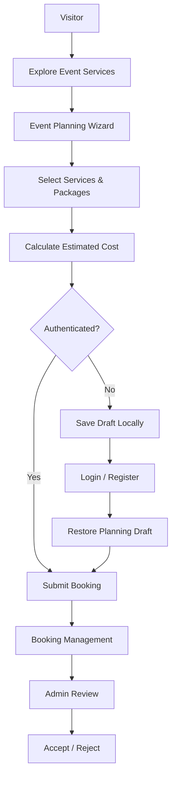
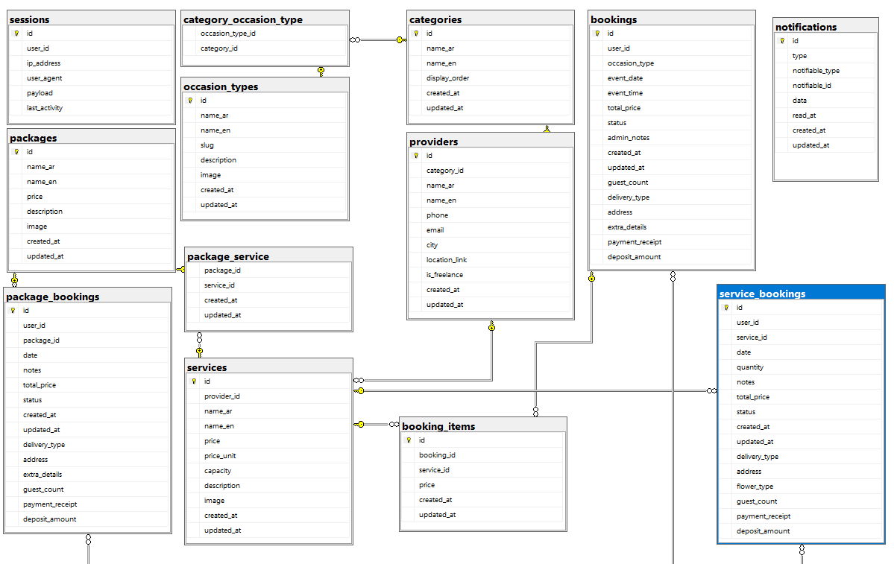
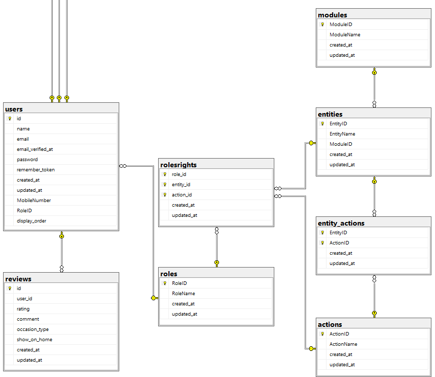
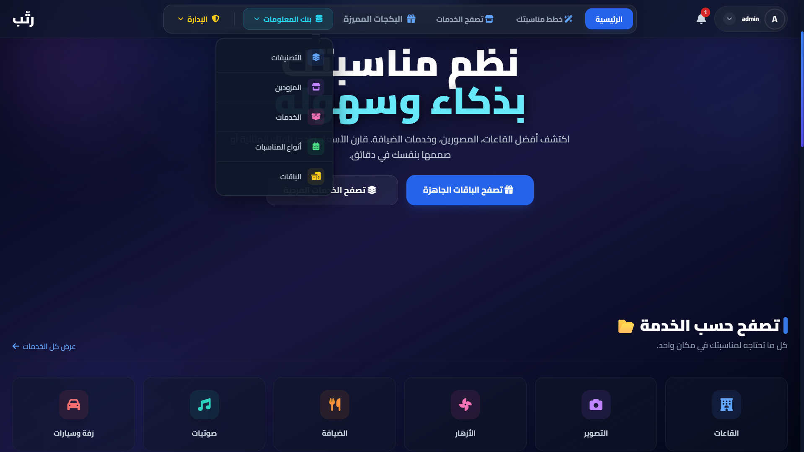
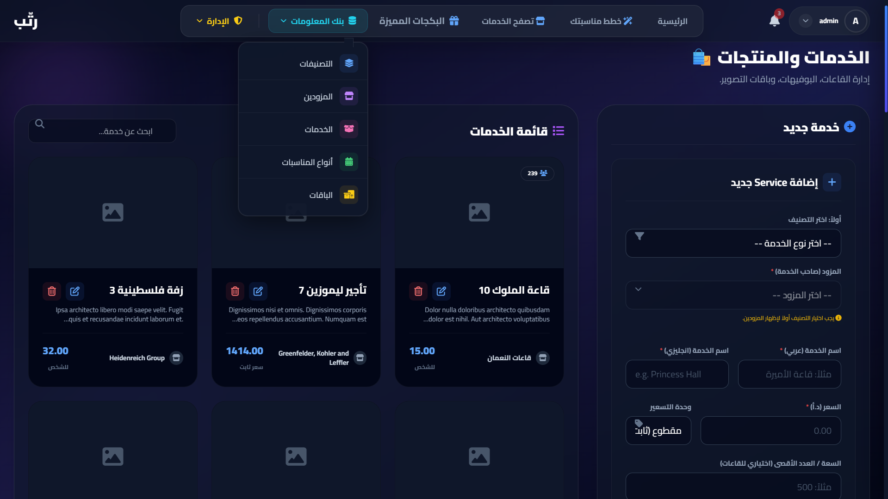
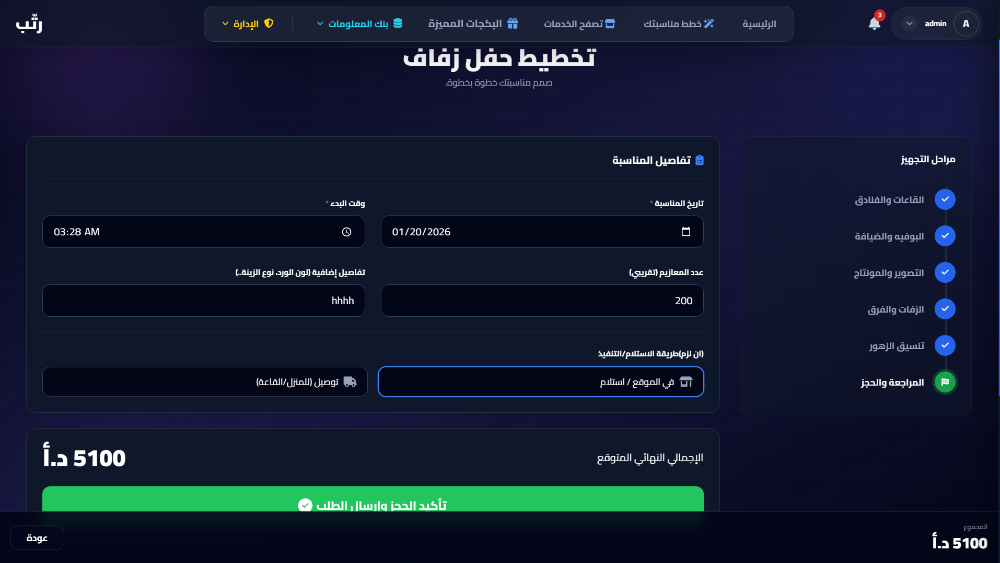
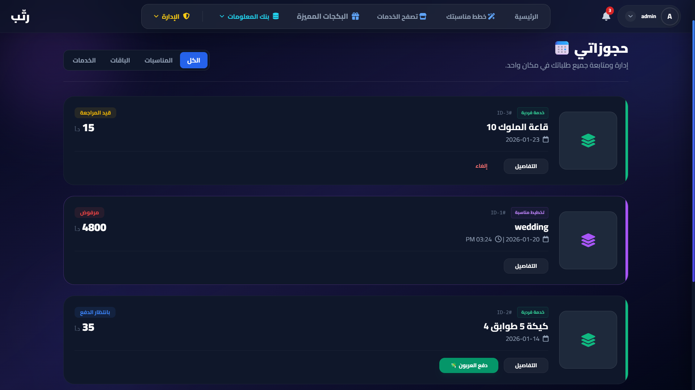
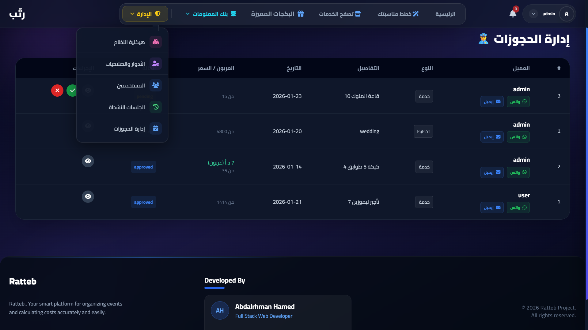

 

 

# 🎉 Ratteb (رتّب)
### Event Planning & Booking Management Platform

**Plan your event, customize services, and manage bookings in one place.**

**Laravel · PHP · SQL Server · Tailwind CSS · Alpine.js**

---

## 📖 Overview

**Ratteb (رتّب)** is a full-stack event planning and booking management platform designed to simplify the process of organizing events.

Planning a wedding, graduation party, meeting, or other occasion often involves coordinating multiple service providers, comparing options, and managing costs.

Ratteb brings these activities together through a centralized web application where users can explore services, customize event plans, calculate estimated costs, and submit booking requests.

The platform also includes an administrative dashboard for managing service providers, categories, pricing, bookings, and user permissions.

The project focuses on combining practical business logic with an interactive user experience using Laravel and modern frontend technologies.

---

## 🚀 Key Features

### 🎯 Interactive Event Planning Wizard

One of the main features of Ratteb is its multi-step event planning wizard.

Instead of requiring users to complete a long form, the application guides them through the planning process step by step.

Users can:

- Select the type of occasion.
- Explore available service categories.
- Choose services and providers.
- Customize their event requirements.
- Review estimated costs.
- Submit their booking request.

The wizard provides a structured approach to event planning while keeping the experience simple and interactive.

### 💾 Draft Persistence & Authentication Flow

Ratteb supports preserving a user's event planning progress before authentication.

When an unauthenticated user starts planning an event, their selections can be stored locally in the browser.

If authentication is required, the user can log in or register and then continue the planning process without starting over.

**Technologies and concepts involved:**

- Browser LocalStorage.
- Laravel authentication.
- Client-side state persistence.
- Form state restoration.
- Multi-step user workflows.

### 💰 Dynamic Cost Calculation

The application calculates estimated event costs based on the services selected by the user.

As services are added or removed, the displayed total is updated to reflect the current selections.

This provides users with a clearer understanding of their estimated event expenses before submitting a booking request.

### 📅 Booking Management

Ratteb includes functionality for managing event booking requests.

Users can submit bookings and review their booking information, while administrators can manage incoming requests through a dedicated dashboard.

Administrative operations include reviewing booking details and updating booking decisions.

### 🗂️ DataBank Management

The platform includes a centralized **DataBank** module for managing the information used throughout the application.

The DataBank supports:

- **Occasion Types:** Weddings, graduations, meetings, and other events.
- **Service Categories:** Venues, catering, decoration, and related services.
- **Service Providers:** Provider information and available offerings.
- **Services:** Individual services, pricing, and related details.
- **Packages:** Configurable combinations of services.

This structure allows administrators to maintain the application's service catalog without modifying the underlying application code for every change.

### 🔐 Authentication & Role-Based Access Control

Ratteb includes authentication and role-based access control to manage access to administrative features.

The system uses roles, permissions, and backend authorization checks to restrict access to protected operations.

### 📱 Responsive Interface

The application uses Tailwind CSS and Alpine.js to provide responsive layouts and interactive user interface components.

---

## 🏗️ Technical Overview

Ratteb is developed using **Laravel and PHP**, with **Microsoft SQL Server** as its relational database.

The application combines backend business logic, relational data management, authentication, and interactive frontend workflows.

### Backend Development

The Laravel backend handles:

- Application business logic.
- Event planning and booking operations.
- Database models and relationships.
- Authentication and authorization.
- Request validation.
- Administrative functionality.
- Service and package management.

### Database Development

Microsoft SQL Server stores the application's relational data.

The database supports relationships between users, occasion types, service categories, providers, services, packages, and bookings.

### Frontend Development

The frontend uses Laravel Blade, Tailwind CSS, Alpine.js, and JavaScript.

These technologies are used to build:

- Responsive pages and forms.
- Multi-step planning interfaces.
- Interactive service selection.
- Dynamic cost updates.
- Administrative dashboards.
- Booking management interfaces.

---

## 🔄 Event Planning Workflow

The application follows a user journey from event customization to booking management.

This workflow demonstrates the interaction between frontend state management, authentication, backend business logic, and booking operations.

---

## 🛠️ Technology Stack

| Category | Technologies |
|---|---|
| Backend | PHP 8.x, Laravel 10.x |
| Database | Microsoft SQL Server |
| ORM | Laravel Eloquent |
| Frontend | Blade, HTML, CSS |
| Styling | Tailwind CSS |
| Interactivity | Alpine.js, JavaScript |
| State Persistence | Browser LocalStorage |
| Authentication | Laravel Authentication |
| Authorization | Role-Based Access Control |
| Architecture | Laravel MVC |
| Version Control | Git, GitHub |

---

## 🗄️ Database Design

Ratteb uses a relational database structure to organize event planning, service management, bookings, and access control.

### Application ERD

### Security ERD

The database design demonstrates:

- Relational data modeling.
- Primary and foreign key relationships.
- Service and category organization.
- Booking-related data management.
- User roles and permissions.
- Separation of application and security-related data.

---

## 📸 Project Gallery

### 🏠 Home Page

The main interface introduces the platform and provides access to event planning features.

### 🗂️ DataBank Management

The administrative interface for managing the platform's service-related information.

### 🎯 Event Planning Wizard

The interactive planning experience that guides users through event customization.

### 📅 My Bookings

A user-facing interface for reviewing submitted event bookings.

### 🛡️ Booking Administration

The administrative interface for reviewing and managing booking requests.

---

## 👨‍💻 My Contributions

**Abdalrhman Hamed — Full-Stack Developer**

I developed Ratteb as a full-stack web application, working across its backend, database, frontend, and administrative functionality.

My work included:

- Developed application functionality using Laravel and PHP.
- Designed and implemented relational database models using Microsoft SQL Server and Eloquent ORM.
- Built the multi-step event planning wizard.
- Implemented browser-based draft persistence to preserve user selections during authentication.
- Developed service selection and dynamic cost calculation functionality.
- Implemented booking submission and administrative booking management.
- Built DataBank modules for managing event types, categories, providers, and services.
- Implemented authentication and role-based access control.
- Developed responsive user interfaces using Blade, Tailwind CSS, and Alpine.js.
- Worked on integrating frontend interactions with backend business logic.

---

## 🧠 Engineering Concepts Demonstrated

Ratteb provided practical experience in several areas of software engineering.

**Business Logic Development**

Translating event planning and booking requirements into application workflows and backend operations.

**Multi-Step Form Management**

Managing user input and navigation across multiple steps while preserving application state.

**Authentication Flow Integration**

Allowing users to begin an interaction before authentication and resume their progress afterward.

**Relational Database Design**

Organizing interconnected data for services, providers, packages, bookings, and access control.

**Administrative System Development**

Building interfaces and backend functionality for managing application data and operational workflows.

**Full-Stack Integration**

Connecting Laravel backend functionality with interactive frontend components.

---

## 🔮 Future Improvements

Potential enhancements include:

- Online payment integration.
- Automated booking notifications.
- Service provider dashboards.
- Availability calendars.
- Additional event customization options.
- Reporting and analytics.
- Automated testing and performance improvements.

---

## 👨‍💻 Developer

**Abdalrhman Hamed**  
Software Engineer | Backend & Full-Stack Development

[LinkedIn](https://www.linkedin.com/in/abdalrhman-hamed-5b929725b/) · [GitHub](https://github.com/abood3omar) · [Instagram](https://www.instagram.com/abood3omar/)

---

*Ratteb (رتّب) — Simplifying event planning through practical software engineering.*
